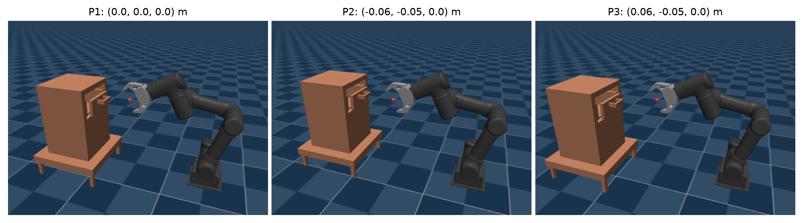
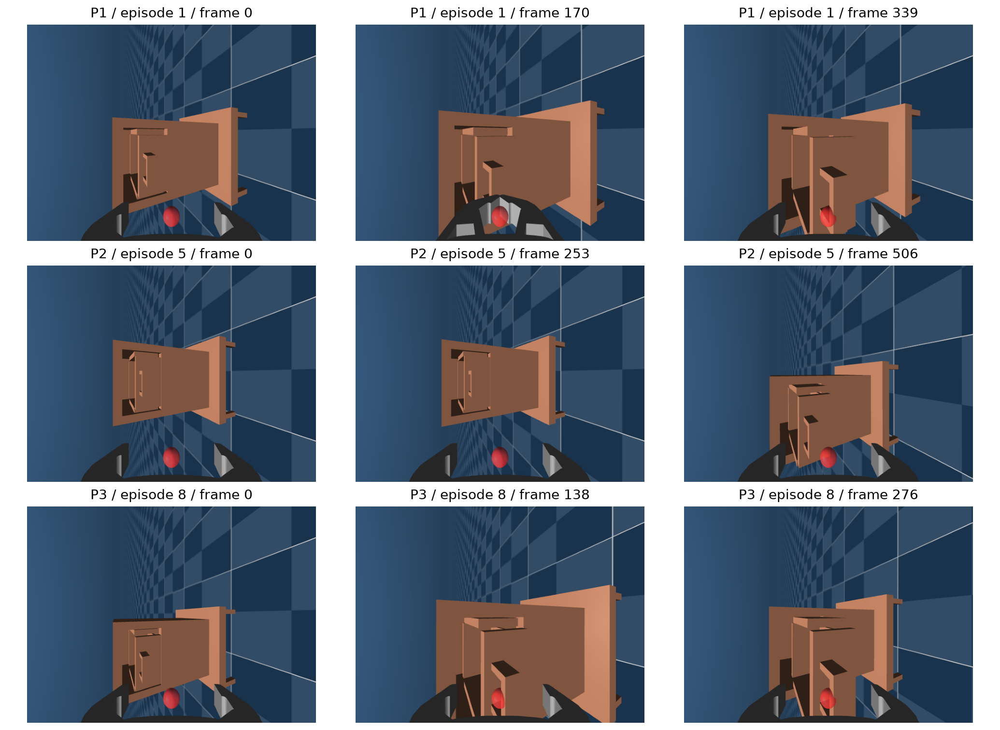
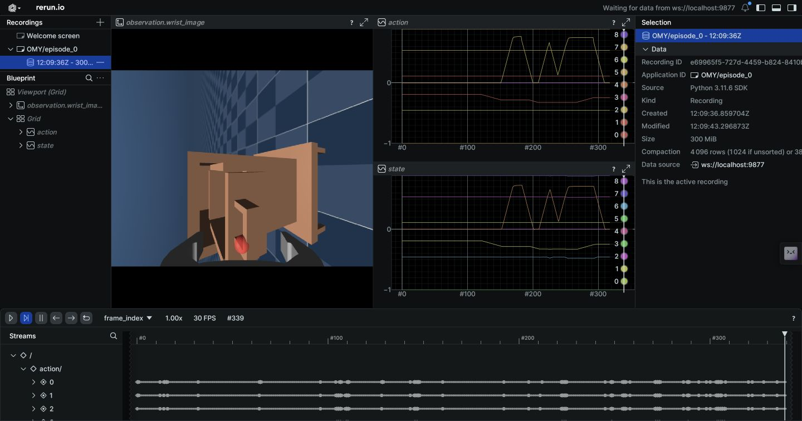
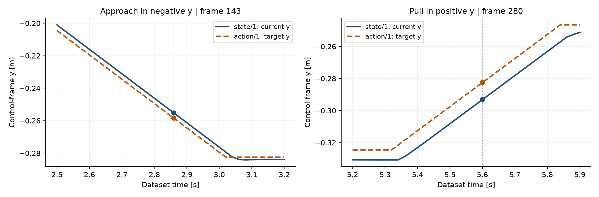
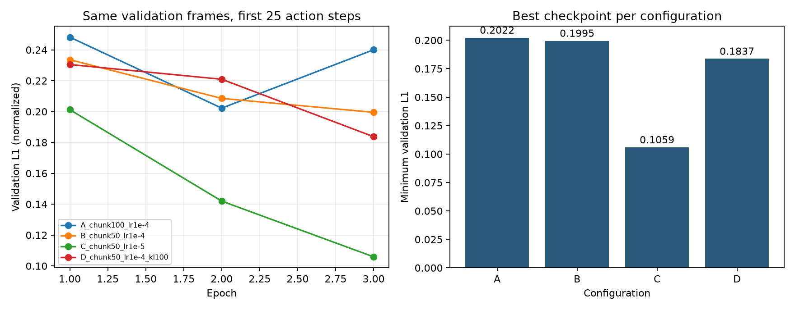
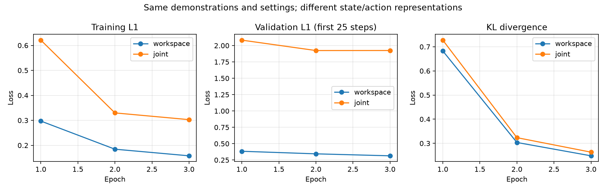

# OMY Cabinet Teleoperation and ACT Learning

MuJoCo에서 OMY 로봇팔로 서랍을 열고, 키보드 시연을 LeRobot 데이터셋으로 기록해 ACT 정책을 학습하는 프로젝트입니다.
캐비넷 세 위치에서 수집한 시연을 사용해 하이퍼파라미터를 비교하고, 같은 시연의 작업공간·관절공간 표현을 각각 학습했습니다.



위 그림은 수집에 사용한 배치를 같은 시점에서 재현한 화면입니다. 로봇 초기 자세를 유지하고 캐비넷 묶음의 위치를 바꿉니다.

## 구현 내용

- **서랍 모델**: MJCF slide 관절로 +y 방향 최대 15 cm 이동
- **키보드 제어**: 말단 목표 위치·자세를 변경하고 Pinocchio IK로 관절 명령 계산
- **반복 수집**: 세 위치에서 각 3회 수집, 저장 후 초기화·재배치, 중단한 순서부터 재개
- **LeRobot 기록**: 손목 RGB 영상, 10D state/action, 캐비넷 위치를 50 Hz로 저장
- **ACT 학습**: 에피소드별 학습·검증 분할, loss 기록, 네 설정 비교
- **표현 비교**: 같은 시연에서 10D 작업공간과 7D 관절공간 데이터를 구성해 별도 학습
- **실행 옵션**: 이동·회전 속도 설정, 그림자·반사 생략, Linux OpenCV Qt 폰트 경로 보정
- **검증**: Rerun 시각화와 전체 프레임 읽기, 수치·인덱스·타임스탬프 검사

```text
키보드 입력 → 말단 목표 자세 → IK → 로봇 관절 제어
                     ↓
      현재 state + 목표 action + 손목 영상 + 캐비넷 위치
                     ↓
             LeRobot 데이터셋 → 시각화·검증 → ACT 학습
```

## 수집 결과

좌표는 `cabinet_root` 기본 위치에 대한 이동량입니다. 캐비넷 본체·서랍·테이블이 함께 이동합니다.

| 위치 | 이동량 (x, y, z), m | 에피소드 인덱스 | 에피소드 수 | 프레임 수 |
|---|---|---|---:|---:|
| P1 | (0.00, 0.00, 0.00) | 0–2 | 3 | 763 |
| P2 | (−0.06, −0.05, 0.00) | 3–5 | 3 | 1,062 |
| P3 | (+0.06, −0.05, 0.00) | 6–8 | 3 | 695 |
| 합계 | 3개 위치 | 0–8 | **9** | **2,520** |

50 Hz 기준 데이터셋 시간은 50.40초이며, 실제 조작에 걸린 시간과는 구분됩니다.
프레임별 메타데이터 검사 결과는 [데이터 요약](docs/dataset_summary.json)에 저장했습니다.



각 행은 P1·P2·P3의 대표 시연(에피소드 인덱스 0·4·7), 각 열은 시작·중간·마지막 프레임입니다. 저장된 이미지에서 직접 추출했습니다.

### 현재 상태와 목표 명령 확인



`lerobot.scripts.visualize_dataset`으로 첫 에피소드의 영상과 state/action을 함께 확인했습니다.
이동 중에는 action이 현재 state보다 진행 방향으로 앞선 목표를 나타내는지 살펴봤습니다.



| 첫 에피소드의 구간 | 프레임 | state y, m | action y, m | action − state |
|---|---:|---:|---:|---:|
| −y 방향 접근 | 143 | −0.25527 | −0.25850 | −3.23 mm |
| +y 방향 당기기 | 280 | −0.29313 | −0.28250 | +10.63 mm |

접근할 때는 더 작은 y값, 당길 때는 더 큰 y값이 앞선 목표입니다. 이는 같은 프레임의 현재 위치와 목표 위치 차이이며, 시간축을 옮겨 비교한 결과는 아닙니다. 정지하거나 목표에 도달하면 두 값이 비슷할 수 있습니다.

## 실행 환경

수집은 Ubuntu 22.04 · WSL2/WSLg · Python 3.11에서, ACT 학습은 Colab GPU에서 실행했습니다.

| 라이브러리 | 사용 버전 |
|---|---|
| MuJoCo | 3.13.0 |
| Pinocchio (`pin`) | 4.1.0 |
| LeRobot | 0.3.3 |
| PyTorch | 2.7.1, 수집 CPU·학습 CUDA |

GPU 학습에 사용한 주요 패키지 버전은 `requirements-colab.txt`에 기록했습니다.

```bash
git clone https://github.com/junseo0im/omy-cabinet-teleop-dataset.git
cd omy-cabinet-teleop-dataset
conda create -n mani python=3.11 -y
conda activate mani
pip install -r requirements.txt
```

### 키보드 조작

```bash
cd src
SPAWN_MODE=three FAST_RENDER=1 MOVE_SPEED=0.15 ROT_SPEED=0.3 python teleoperation.py
```

MuJoCo 뷰어 창에 포커스를 둔 상태에서 입력합니다.

| 키 | 기능 |
|---|---|
| ← / → | −y 접근 / +y 당기기 |
| ↑ / ↓ | −x / +x 이동 |
| J / K | 아래 / 위 이동 |
| Y / U | roll 증가 / 감소 |
| Space | 그리퍼 닫기 / 열기 |
| Right Shift | 녹화 시작 (`collect_data.py`) |
| Left Shift | 초기화; 수집 프로그램에서는 에피소드 저장 후 초기화 |

이동·회전 키는 다른 키를 누를 때까지 적용됩니다. U는 roll을 감소시키는 키이므로 수평 자세에서 다른 키로 회전을 멈춥니다.
제어 프레임은 손목 플랜지이며, 손목 영상의 빨간 표식은 손가락 쪽 기준점입니다.

### 데이터 수집

`src`에서 실행합니다.

```bash
SPAWN_MODE=three NUM_DEMO=9 FAST_RENDER=1 MOVE_SPEED=0.15 ROT_SPEED=0.3 python collect_data.py
```

`three` 모드는 P1·P2·P3에서 각각 3회 수집합니다. `NUM_DEMO`는 이미 저장된 에피소드를 포함한 총 목표 개수입니다.
시작 메뉴에서 **1번은 기존 데이터 삭제 후 새로 생성**, **2번은 이어서 수집**입니다. 각 에피소드마다 Right Shift로 녹화를 시작하고 Left Shift로 저장합니다.
현재 수집 스크립트는 작업공간 시연과 관절값을 함께 `dataset/cabinet_opening_three_positions_paired/`에 기록합니다. 아래 릴리스의 기존 데이터셋은 `dataset/cabinet_opening_three_positions/`에 별도로 둡니다.
`fixed`, `grid`, `random` 배치 모드도 지원합니다.

| 옵션 | 기본값 | 의미 |
|---|---|---|
| `MOVE_SPEED` | 0.1 | 이동 속도, m/s (시뮬레이션 시간 기준) |
| `ROT_SPEED` | 0.1 | 회전 속도, rad/s (시뮬레이션 시간 기준) |
| `FAST_RENDER` | 0 | 1이면 그림자·반사 생략 |

### 수집 데이터 다운로드·시각화

원본 데이터는 [v0.1.0 릴리스](https://github.com/junseo0im/omy-cabinet-teleop-dataset/releases/tag/v0.1.0)의 `cabinet-opening-three-positions.zip`으로 제공합니다. `SHA256SUMS`로 파일 해시를 확인할 수 있습니다.
다운로드한 ZIP을 레포 루트에서 풀면 `dataset/cabinet_opening_three_positions/`가 생성됩니다.

```bash
# 레포 루트에서
unzip cabinet-opening-three-positions.zip
cd src
python -m lerobot.scripts.visualize_dataset --repo-id OMY \
  --root ../dataset/cabinet_opening_three_positions --episode-index 0 --num-workers 0
```

구조 검증과 추가 그래프는 `analysis`에서 실행합니다.

```bash
cd ../analysis
python audit_dataset.py --root ../dataset/cabinet_opening_three_positions \
  --output ../docs/dataset_summary.json
python plot_dataset.py ../dataset/cabinet_opening_three_positions 0
```

## 데이터 형식

| 필드 | 형태 | 내용 |
|---|---|---|
| `observation.wrist_image` | (480, 640, 3) | 손목 카메라 RGB |
| `observation.state` | (10,) | 현재 위치 3 + 6D 회전 표현 6 + 그리퍼 1 |
| `action` | (10,) | 목표 위치 3 + 6D 회전 표현 6 + 그리퍼 명령 1 |
| `cabinet_pos` | (3,) | cabinet_root 이동량 |

영상은 Parquet 안의 이미지 바이트로 저장합니다. 별도 MP4 파일은 생성하지 않았습니다.
state/action의 인덱스 0–2는 위치, 3–8은 회전 표현, 9는 그리퍼 값입니다.

## ACT 학습

기존 9개 에피소드 중 0·1·3·4·6·7번을 학습에, 2·5·8번을 검증에 사용했습니다. 정규화 통계는 학습 에피소드에서만 계산합니다. 학습은 50 Hz 시연의 손목 영상과 state/action을 사용하며, loss와 체크포인트는 `train/`에 저장됩니다.

```bash
# 레포 루트에서 실행; 원본 데이터셋은 위 릴리스에서 내려받아 dataset/에 압축 해제
python tools/run_hyperparameter_search.py --device cuda --epochs 3 --batch-size 8
```

네 설정은 action chunk, 학습률, KL 가중치를 바꿔 비교했습니다. 모든 설정은 3 epoch, batch 8, seed 0, 동일한 검증 에피소드와 예측 구간 25 step을 사용했습니다. 검증 지표는 패딩을 제외한 정규화 L1의 최솟값입니다.

| 설정 | chunk | 학습률 | KL 가중치 | 최소 검증 L1 |
|---|---:|---:|---:|---:|
| A | 100 | 1e-4 | 10 | 0.2022 |
| B | 50 | 1e-4 | 10 | 0.1995 |
| C | 50 | 1e-5 | 10 | **0.1059** |
| D | 50 | 1e-4 | 100 | 0.1837 |



설정과 측정값은 [act_selection.json](docs/act_selection.json)에 기록했습니다. 최종 성능이 아니라 3 epoch 동안의 비교 결과입니다.

### 작업공간과 관절공간 비교

새 시연을 수집할 때 `JOINT_SPACE=0`을 지정하면 10D 작업공간 state/action과 7D 관절값을 같은 프레임에 기록합니다. 원본 수집 데이터와 구분해 `dataset/cabinet_opening_three_positions_paired/`에 저장합니다.

```bash
cd src
SPAWN_MODE=three JOINT_SPACE=0 NUM_DEMO=9 FAST_RENDER=1 MOVE_SPEED=0.15 ROT_SPEED=0.3 python collect_data.py
cd ..
python tools/make_joint_dataset.py dataset/cabinet_opening_three_positions_paired
python tools/compare_action_spaces.py --device cuda --epochs 3 --batch-size 8
```

변환 스크립트는 함께 기록한 관절값을 관절공간 데이터셋의 7D state/action으로 옮깁니다. 이 과정에서 별도의 시연을 합성하지 않습니다. 비교에는 세 위치에서 수집한 9개 에피소드·2,306프레임을 사용했습니다. 두 정책은 각각 새로 학습했으며, 위 비교에서 선택한 설정 C를 공통으로 적용했습니다.

| 표현 | state/action 차원 | 최소 검증 L1 | 해당 epoch |
|---|---:|---:|---:|
| 작업공간 | 10 | 0.3142 | 3 |
| 관절공간 | 7 | 1.9241 | 2 |



세부 설정과 측정값은 [act_space_comparison.json](docs/act_space_comparison.json)에 기록했습니다. 좌표계와 차원, 정규화 기준이 달라 두 L1 값을 제어 성공률처럼 직접 비교할 수는 없습니다.

## 범위와 한계

수집 중 뷰어에서 서랍 열림을 확인했습니다. 전체 2,520프레임의 영상 읽기, 유한한 state/action, 프레임 인덱스와 50 Hz 타임스탬프를 검사했습니다.
서랍 변위와 성공 라벨은 별도로 기록하지 않아 정량 성공률은 산출하지 않았습니다. ACT 정책의 실제 rollout 성공률과 새로운 위치에 대한 일반화 성능은 아직 평가하지 않았습니다.
배치 전 IK 검사는 파지·당기기 끝점의 도달 가능성과 관절 범위를 확인합니다. 연속 경로의 충돌 검사는 포함하지 않습니다.

## 파일 구성과 참고

- `src/`: 키보드 제어, IK, 수집·배치·실행 옵션, ACT 학습
- `tools/`: 관절공간 데이터 변환과 학습 설정 비교
- `asset/`: MJCF, URDF, 메시 파일
- `analysis/`: 도달 가능성 분석, 데이터 검증·그래프 생성
- `docs/`: 수집·학습 결과 요약과 이미지

MuJoCo 서랍·키보드 제어 예제 코드를 바탕으로 배치 계획, 수집 재개, 데이터 기록과 ACT 학습을 확장했습니다.
ROBOTIS OMY 모델의 라이선스는 [원본 라이선스](asset/robotis_omy/LICENSE)를 따릅니다.
