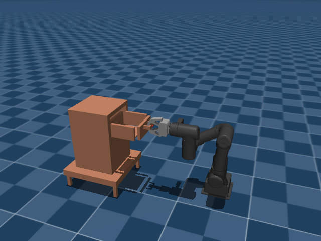
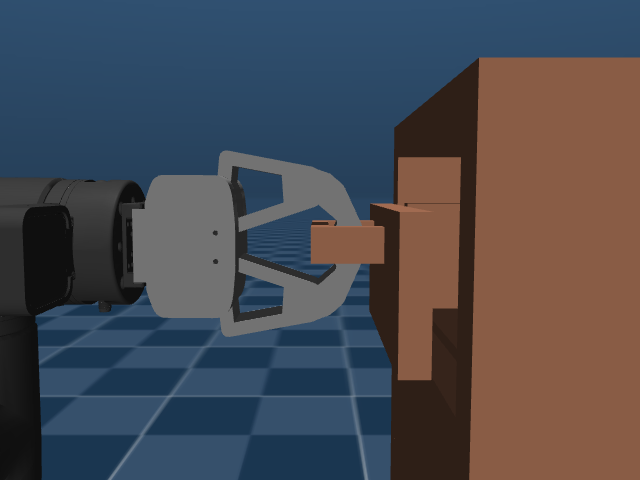
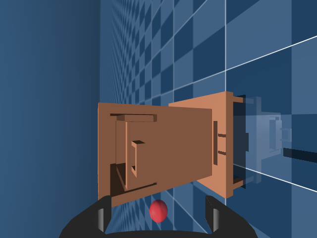
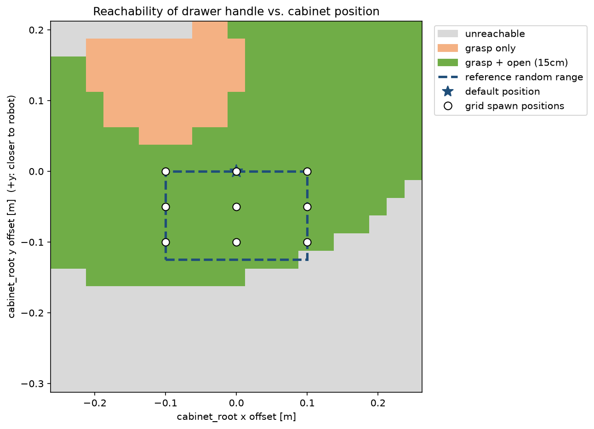

# OMY Cabinet Teleoperation & Dataset

MuJoCo 시뮬레이터에서 ROBOTIS **OpenManipulator-Y (OMY)** 6축 로봇팔로 **서랍을 여는 작업**을 수행하고,
키보드 텔레오퍼레이션으로 전문가 시연을 수집해 **LeRobot 데이터셋**으로 저장하는 파이프라인.
캐비넷 위치를 에피소드마다 바꿔 다양한 환경에서의 데이터를 모을 수 있으며, 로봇이 실제로 작업 가능한 위치만 고르도록 **IK 기반 도달 가능성 검사**를 함께 수행한다.

<p align="center">
  
  
</p>

## 주요 기능

- **슬라이딩 서랍장 (MJCF)**: `drawer_slide` 직선 관절(+y, 0–15 cm)을 가진 캐비넷 모델
- **키보드 텔레오퍼레이션**: 키 입력 → 엔드이펙터 목표 자세 → Pinocchio IK → 관절 위치 제어 (50 Hz)
- **LeRobot 데이터셋 기록**: 손목 카메라 이미지(480×640) + 상태 + 행동 + 캐비넷 위치
- **캐비넷 배치 모드**: `fixed` / `grid` (3×3 순환) / `random` (도달 불가능 위치 자동 제외)
- **분석 도구**: 작업공간 도달 가능성 히트맵, 데이터셋 위치 분포·궤적·프레임 시각화

## 구조

```
.
├── asset/
│   ├── scene.xml                # 로봇 + 캐비넷 통합 장면
│   ├── object/cabinet.xml       # 슬라이딩 서랍장
│   ├── robotis_omy/             # OMY MJCF 모델 (ROBOTIS, Apache-2.0)
│   └── urdf_omy/omy.urdf        # Pinocchio IK용 URDF
├── src/
│   ├── teleoperation.py         # 키보드 조종 (기록 없음)
│   ├── collect_data.py          # 키보드 조종 + LeRobot 데이터셋 기록
│   ├── cabinet_spawn.py         # 캐비넷 배치 / 도달 가능성 검사
│   └── ik.py                    # Damped least-squares IK
├── analysis/
│   ├── workspace_analysis.py    # 캐비넷 위치별 도달 가능성 분석
│   └── plot_dataset.py          # 데이터셋 요약 그림
└── docs/figures/                # README / 보고서용 그림
```

## 환경

| 항목 | 버전 |
|---|---|
| OS | Ubuntu 22.04 (WSL2 + WSLg) |
| Python | 3.11 (conda) |
| MuJoCo | 3.13.0 |
| Pinocchio | 4.1.0 (`pin`) |
| LeRobot | 0.3.3 |

```bash
conda create -n mani python=3.11 -y && conda activate mani
pip install -r requirements.txt
```

## 실행

```bash
cd src
python teleoperation.py                              # 조종 연습
python collect_data.py                               # 랜덤 위치, 50 에피소드
SPAWN_MODE=grid NUM_DEMO=9 python collect_data.py    # 3x3 격자 위치에서 1개씩
```

| 키 | 동작 |
|---|---|
| ← / → | 엔드이펙터 −y (캐비넷 쪽) / +y (로봇 쪽) |
| ↑ / ↓ | 엔드이펙터 −x / +x |
| J / K | 엔드이펙터 아래 / 위 |
| Y / U | roll + / − (그리퍼 기울기) |
| Space | 그리퍼 닫기 / 열기 |
| Right Shift | 녹화 시작 |
| Left Shift | 에피소드 저장 후 리셋 (다음 캐비넷 위치로 재배치) |

> 키는 한 번 누르면 다른 키를 누를 때까지 계속 적용된다.
> 키로 움직이는 제어점은 손목 플랜지(`link6`)이며, 실제 손가락 끝은 그보다 약 22 cm 앞에 있다.
> 손목 카메라의 **빨간 점**이 손가락 끝 기준점이다.

### 데이터셋 시각화

```bash
python -m lerobot.scripts.visualize_dataset --repo-id OMY \
    --root ../dataset/cabinet_opening_random_spawn --episode-index 0 --save 1 --output-dir ../rrd
rerun --web-viewer ../rrd/OMY_episode_0.rrd     # 브라우저에서 http://localhost:9090
cd ../analysis && python plot_dataset.py ../dataset/cabinet_opening_random_spawn 0
```

## 데이터 형식

| key | shape | 내용 |
|---|---|---|
| `observation.wrist_image` | (480, 640, 3) | 손목 카메라 RGB |
| `observation.state` | (10,) | 현재 EE 위치(3) + 6D 회전(6) + 그리퍼(1) |
| `action` | (10,) | 목표 EE 위치(3) + 6D 회전(6) + 목표 그리퍼(1) |
| `cabinet_pos` | (3,) | 해당 에피소드의 캐비넷 위치 (정책 입력에는 사용되지 않음) |

<p align="center"></p>

## 캐비넷 위치와 도달 가능성

캐비넷을 (x, y) 격자로 옮겨가며 손잡이 파지 자세와 서랍을 15 cm 당긴 자세에 대해 IK 해를 계산했다.

<p align="center"></p>

- 기본 랜덤 범위(x ±0.1 m, y −0.125–0 m) 54칸 중 53칸에서 파지·열기 모두 가능하며, 오른쪽 아래 모서리(x = 0.1, y = −0.125)는 도달 불가.
- 캐비넷이 로봇에 가까워지면(y > 0.04) 손잡이는 잡을 수 있지만 팔이 접혀 15 cm를 당기지 못한다.
- 격자 모드의 9개 위치는 모두 작업 가능 영역 안에 있다.
- 분석은 IK 해 존재와 관절 한계만 고려하며, 팔–캐비넷 충돌은 포함하지 않는다.

## 결과

텔레오퍼레이션 데이터 수집 결과와 데이터셋 시각화는 수집 후 추가.
